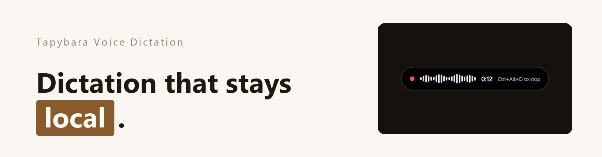
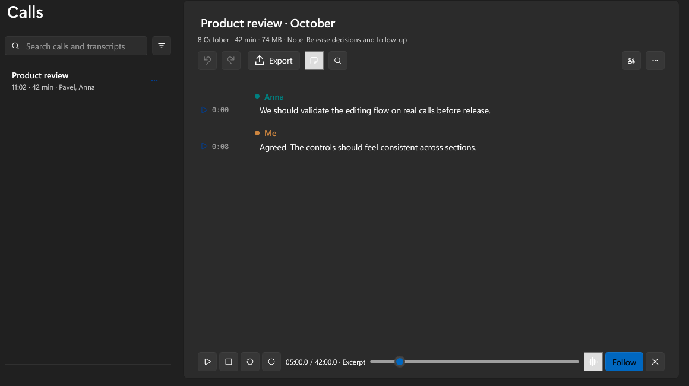

[](https://github.com/keshon/tapybara/actions/workflows/build.yml) [](https://github.com/keshon/tapybara/releases) [](LICENSE)

# Tapybara

Local voice dictation and call transcription for Windows. Dictate into the application you're using, or record a call and review its transcript alongside the audio. Speech recognition runs on your computer through [whisper.cpp](https://github.com/ggerganov/whisper.cpp), with optional Vulkan GPU acceleration.

[Website](https://tapybara.keshon.ru/) · [Download the latest release](https://github.com/keshon/tapybara/releases/latest) · [User guide](docs/running.md)

<picture>
  <source media="(prefers-color-scheme: light)" srcset="docs/product-design/validation/calls-light.png">
  
</picture>

*Calls workspace with a sample transcript. Light and dark themes are supported.*

## Dictation

- Press **Ctrl+Alt+D** to start speaking; press it again to transcribe and insert text at the caret.
- Customize recognition with a dictionary of names and terms.
- Keep an optional, searchable dictation history for reviewing and copying previous text.
- Manage models, shortcuts, and recognition settings inside the app.

## Calls

- Press **Ctrl+Alt+C** to record microphone and system audio as separate tracks.
- Transcribe locally, review detected speakers, and name voices for future recordings.
- Edit transcript text, split and merge lines, assign speakers, add missing speech, and correct timing. Changes support undo and redo within the editing session.
- Find and replace text in the current call.
- Seek from transcript timestamps, follow the playing line, zoom and pan the waveform, and loop a selected audio range.
- Search and filter the recording library. Export transcripts as text, Markdown, or JSON, with configurable speaker labels and timestamps.

Speaker detection and phrase timing can need manual correction, especially with overlapping speech. Estimated timing is marked with `~`. The speaker timeline shows transcript activity; it does not isolate individual voices from the recording.

## Import media

Choose **+ (New transcription)** beside the Calls filter button to open the import workspace, then drop an audio/video file or click to browse. Tapybara keeps its own audio copy and opens the result in the same transcript editor. Import and transcription can be cancelled separately. Choose a recognition language in the import workspace; it defaults to Settings and is saved with that session. Imported media has no assumed microphone owner. An optional speaker count includes everyone heard in the file.

Windows codecs handle common formats. For formats Windows cannot decode, install FFmpeg on PATH or place `ffmpeg.exe` beside `Tapybara.exe`.

If automatic speaker separation produces excessive groups, the transcript stays usable and the app asks for a speaker count. Use **People → … → Redo speaker detection…** to retry without retranscribing the text. Named sample identities and manually assigned phrases are retained. Similar unnamed groups may suggest an existing name; accepting the same name combines them into one person. After correcting a sample, use **Find similar speech…** on that person’s card, then **Review matches** to listen and apply selected suggestions. Speaking percentages show the share of speech, not recognition confidence. The playback lock switches between an excerpt and the whole call.

## Install

Download a Windows x64 package from the [latest release](https://github.com/keshon/tapybara/releases/latest):

- **Setup:** run `Tapybara-win-Setup.exe`. It installs for the current user without administrator rights and supports automatic updates. Update checks can be disabled in Settings.
- **Portable ZIP:** extract `Tapybara-*-win-x64.zip` and run `Tapybara.exe`. Create an empty `portable.txt` beside the executable to keep settings, models, and data in that folder. Update this copy manually by downloading a new ZIP.

Release builds include the .NET runtime. Windows 10 version 2004 or newer, or Windows 11, is required. A Vulkan-capable GPU is recommended; CPU recognition is also supported. No CUDA Toolkit is needed.

On first launch, download a speech model through onboarding or **Settings → Models**. Model downloads and optional update checks need internet access; recording and speech processing run locally and work offline once the required models are available. No account is required.

The default shortcuts are **Ctrl+Alt+D** for dictation and **Ctrl+Alt+C** for call recording. Both can be changed in Settings. See the [user guide](docs/running.md) for audio setup, models, and storage locations.

## Development

Requires Windows and the **.NET 10 SDK**.

```powershell
git clone https://github.com/keshon/tapybara.git
cd tapybara
build.cmd run
```

Run the test suite with:

```powershell
build.cmd test
```

Close the app before rebuilding its output directory.

- `src/Tapybara.Core` — audio capture, transcription, settings, and transcript editing logic.
- `src/Tapybara.App` — WPF application, pages, and shared controls.
- `tests` — Core and application tests.
- `tools` — supporting utilities and benchmarks.

Read the [contributor conventions](docs/conventions.md) and [architecture guide](docs/architecture.md) before changing the code. The [product design notes](docs/product-design/) document the Calls workspace and shared UI work.

Tagged releases are built and tested by [GitHub Actions](.github/workflows/build.yml), which publishes the installer, portable ZIP, and update packages. The release procedure and release-note format are documented in [conventions](docs/conventions.md).

## License

[MIT](LICENSE).
